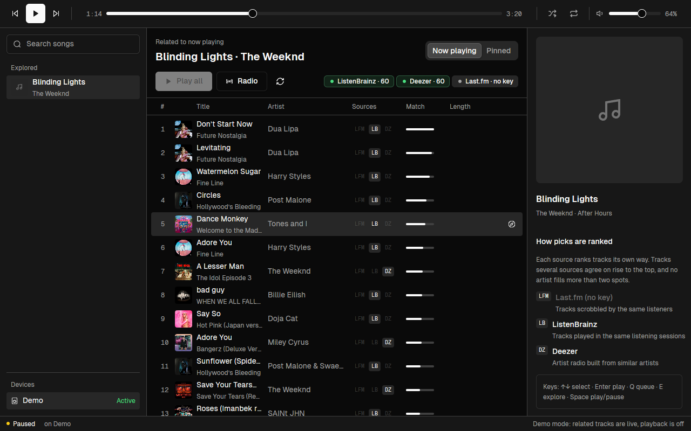

# spotify-related

A cross-platform Spotify player built around one feature: a good list of related songs for whatever is playing.

Spotify's own "related" data is a single black box, and its public API for it was shut off for new apps in 2024. spotify-related asks open music-data services instead, merges their answers, shows you where each pick came from, and plays the result on your Spotify account.



The UI is written in Rust with [GPUI](https://www.gpui.rs) and the [mkit](https://github.com/s4njee/mkit) component kit (shadcn dark theme, Geist type). It runs on macOS, Windows and Linux.

## How the related list is built

For the seed song, three sources are asked in parallel:

| Source | Signal | Key needed |
| --- | --- | --- |
| **Last.fm** `track.getSimilar` | Tracks scrobbled by the same listeners. The strongest track-level signal. Falls back to similar artists' top tracks for rare songs. | Free API key |
| **ListenBrainz** similar recordings | Tracks played in the same listening sessions (open data). The seed is matched on MusicBrainz by ISRC, or by title and artist. | No |
| **Deezer** artist radio | A mix of the seed artist and similar artists. Coarser, but covers new and regional releases. | No |

The lists are merged with weighted reciprocal-rank fusion: each source contributes `weight × 11 / (10 + rank)` to a track's score, so a song two sources agree on beats a song one source ranked slightly higher. Titles and artists are normalised across catalogs ("Song - 2011 Remaster", "Song (feat. X)", accents and curly quotes), other versions of the seed itself are dropped, and no artist gets more than two spots. Each pick is then found on Spotify, by ISRC when the source has one and by a verified title-and-artist search otherwise.

Every row shows which sources suggested it (hover a pill for that source's rank and similarity) and a match bar for the fused score.

You can try the pipeline without the UI or a Spotify account:

```sh
cargo run -p related-core --example related -- "The Weeknd" "Blinding Lights"
LASTFM_API_KEY=... cargo run -p related-core --example related -- "Kate Bush" "Running Up That Hill"
```

## What you can do

- **Follow now playing** (default): the list updates whenever the song changes, wherever it is playing.
- **Explore** any song (search result, history entry or related row) to see its neighbours without playing it. This pins the list.
- **Play**, **Add to queue**, or **Play all** related tracks in ranked order.
- **Radio**: shortly before each song ends, the best related track you have not heard this session is added to the queue, so playback keeps walking the related graph.
- Transport, seek, volume, shuffle, repeat, and switching between Spotify Connect devices.

Keyboard, in the related list: <kbd>↑</kbd>/<kbd>↓</kbd> (or <kbd>j</kbd>/<kbd>k</kbd>) select, <kbd>Enter</kbd> play, <kbd>Q</kbd> queue, <kbd>E</kbd> explore, <kbd>Space</kbd> play/pause. Anywhere: <kbd>Cmd/Ctrl</kbd>+<kbd>←</kbd>/<kbd>→</kbd> previous/next, <kbd>Cmd/Ctrl</kbd>+<kbd>P</kbd> play/pause, <kbd>Cmd/Ctrl</kbd>+<kbd>R</kbd> refresh the list.

## Setup

You need **Spotify Premium** (Spotify only lets Premium accounts be controlled through its API) and Spotify running on at least one device: the desktop or mobile app, a speaker, or a Connect daemon such as [spotifyd](https://github.com/Spotifyd/spotifyd). spotify-related controls that device; it does not play audio itself yet (see [Roadmap](#roadmap)).

1. Create an app at the [Spotify developer dashboard](https://developer.spotify.com/dashboard). Add the redirect URI `http://127.0.0.1:8898/callback` and tick **Web API**. Spotify keeps new apps in development mode, which only lets accounts listed under **User Management** sign in, so add your own account there.
2. Optionally get a free [Last.fm API key](https://www.last.fm/api/account/create). Without it the list uses ListenBrainz and Deezer only.
3. Run the app, paste the client ID (and Last.fm key), and choose **Sign in with Spotify**. Your browser opens Spotify's consent page; afterwards the app keeps a refresh token so you only do this once.

To look around first, run it with `--demo`: the related list is live for a sample song, but nothing plays.

```sh
cargo run --release -p spotify-related            # the app
cargo run --release -p spotify-related -- --demo  # no Spotify account needed
```

The app asks only for playback scopes (`user-read-playback-state`, `user-modify-playback-state`, `user-read-currently-playing`). It never reads or changes your library or playlists.

### Configuration

Settings live in `config.toml` in the platform config directory (`~/.config/spotify-related/` on Linux, `~/Library/Application Support/spotify-related/` on macOS, `%APPDATA%\spotify-related\` on Windows). The setup screen writes it; you can also edit it by hand:

```toml
spotify_client_id = "your-client-id"
lastfm_api_key = "your-lastfm-key"   # optional
redirect_port = 8898                 # must match the redirect URI on your Spotify app
max_per_artist = 2                   # cap per artist in the related list
list_size = 40

[sources]                            # set a weight to 0 to turn a source off
lastfm_weight = 1.0
listenbrainz_weight = 1.0
deezer_weight = 0.6
```

`SPOTIFY_CLIENT_ID`, `LASTFM_API_KEY` and `SPOTIFY_REDIRECT_PORT` override the file. The refresh token is stored next to it in `token.json` (readable only by you on macOS and Linux). Spotify matches are cached in the platform cache directory.

## Building

Rust 1.92 or newer. GPUI and mkit are pinned to the versions mkit is tested with (`gpui-pre` 0.3.5, mkit `d5f1a07`).

- **macOS**: Xcode and its command line tools (`xcode-select --install`).
- **Windows**: the MSVC Rust toolchain with Visual Studio C++ Build Tools and a Windows SDK.
- **Linux**: a C toolchain, `pkg-config`, and the X11/Wayland, Vulkan and font development packages. On Ubuntu:

  ```sh
  sudo apt-get install build-essential clang pkg-config libxkbcommon-x11-dev libwayland-dev \
    libx11-xcb-dev libfontconfig-dev libssl-dev libvulkan1 libzstd-dev libglib2.0-dev libasound2-dev
  ```

Then `cargo build --release -p spotify-related`. `cargo test --workspace` runs the unit tests for parsing, normalisation, fusion and the OAuth callback.

## Layout

```
crates/related-core   No UI. Config, Spotify Web API client (PKCE sign-in, Connect playback,
                      search), the Last.fm / ListenBrainz / Deezer providers, fusion, and the
                      engine that resolves picks to Spotify tracks. Synchronous; runs on
                      GPUI's background executor.
crates/app            The GPUI window. player.rs holds state and async work; ui/ renders it
                      with mkit components (Button, IconButton, Slider, SearchField,
                      SegmentedControl, Badge, Tooltip, EmptyState, Progress).
```

## Roadmap

- **Built-in audio** through [librespot](https://github.com/librespot-org/librespot), so the app can be its own Connect device instead of needing another Spotify client running.
- More sources (for example Discogs styles or MusicBrainz tags) and per-source tuning in the UI.
- A settings screen for weights and the per-artist cap, and an mkit light theme toggle.
- Saving a related list as a Spotify playlist (needs one more scope).

## Credits

Related-track data from [Last.fm](https://www.last.fm/api), [ListenBrainz](https://listenbrainz.org) and [MusicBrainz](https://musicbrainz.org) (open data), and [Deezer](https://developers.deezer.com). Cover art from Spotify and the [Cover Art Archive](https://coverartarchive.org). The Geist and Geist Mono fonts are by Vercel under the SIL Open Font License (`crates/app/assets/fonts/OFL.txt`).
